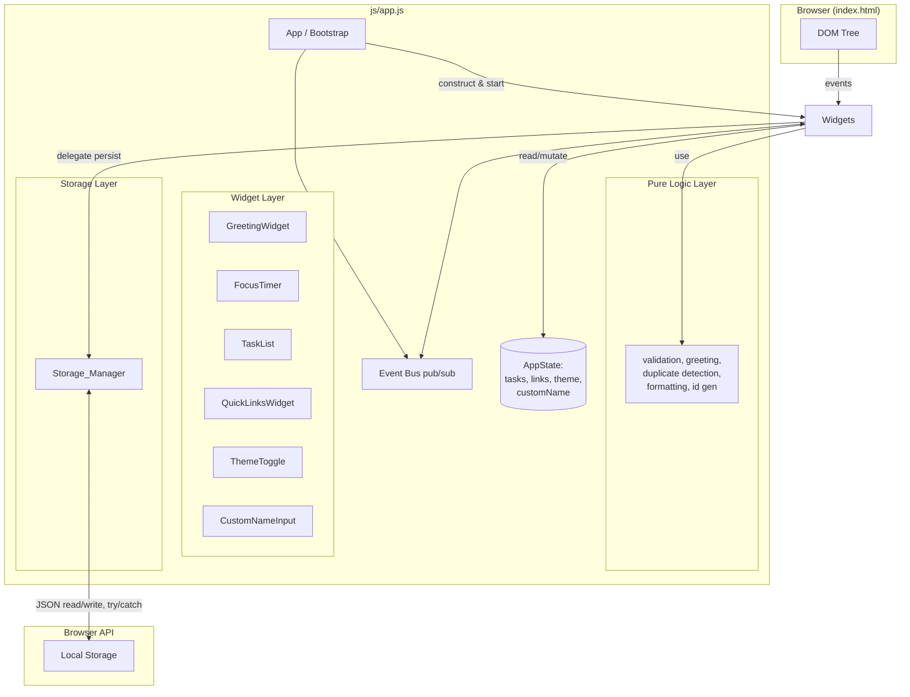

# Design Document

## Overview

The Productivity Dashboard is a single-page, browser-only web application with no backend server and no JavaScript framework. It is composed of four core widgets (Greeting, Focus Timer, To-Do List, Quick Links) and three optional controls (Theme Toggle, Custom Greeting Name, Duplicate Task Prevention). All user data is persisted client-side in the browser's Local Storage API as JSON.

This design documents the system architecture, component breakdown, data models, control/data flow, theming, persistence, and error-handling strategy for the application. A key design goal is to separate **pure, input-driven logic** (validation, greeting calculation, duplicate detection, serialization) from **DOM and storage side effects**. Keeping pure logic in standalone functions makes it independently testable with property-based testing while leaving the DOM and Local Storage layers to example-based and integration tests.

**Design goals:**
- Maintainability through clear component boundaries and a single source of truth for shared state.
- Testability by isolating pure functions from side-effectful DOM and storage code.
- Resilience by treating every Local Storage read/write as a fallible operation and degrading gracefully on failure.
- Performance by keeping rendering synchronous and lightweight, with no build step or framework runtime.

## Architecture

### High-Level Architecture

The application follows a three-layer architecture inside a single `js/app.js` file:

1. **Pure Logic Layer** — stateless functions with no DOM or storage access. Includes greeting calculation, input validation, duplicate detection, ID generation, and time formatting. These are the primary targets for property-based testing.
2. **Storage Layer** — `Storage_Manager`, the single module that reads from and writes to Local Storage. All persistence flows through this module so that error handling and serialization format live in one place.
3. **Widget Layer** — ES6 classes that own a region of the DOM, render state, and wire DOM events. Widgets read and mutate shared application state but never touch Local Storage directly; they delegate to `Storage_Manager`.

A small **App / bootstrap** module constructs the shared state object, wires cross-widget communication through a lightweight pub/sub event bus, and starts the widgets. A central `AppState` object is the single source of truth for tasks, links, theme, and the custom name.



### Project Structure

Per Requirement 9, the project uses exactly one HTML entry point, one CSS file, and one JavaScript file, with no framework references:

```
/
├── index.html          # single entry point (root directory)
├── css/
│   └── styles.css      # single stylesheet (theming via CSS custom properties)
└── js/
    └── app.js          # single JS file (all modules, no framework)
```

### Module Organization Within app.js

Because the project mandates a single JavaScript file, modules are organized as clearly delimited sections inside one IIFE-scoped or module-scoped file. Each module is an ES6 class or a plain object of pure functions. Recommended section layout:

```
app.js
├── "use strict"
├── Constants (storage keys, timer duration, limits)
├── Pure Logic functions
├── EventBus class
├── Storage_Manager
├── AppState
├── Widget classes (GreetingWidget, FocusTimer, TaskList, QuickLinksWidget, ThemeToggle, CustomNameInput)
└── App bootstrap (DOMContentLoaded)
```

### Design Decisions and Rationale

- **Single source of truth (`AppState`)** rather than letting each widget keep its own copy of data. This avoids divergence between the to-do list's in-memory model and what is rendered, and makes persistence a single, well-defined operation.
- **Centralized `Storage_Manager`** so the JSON format, key naming, and error handling (quota errors, parse errors) are defined once. Widgets never call `localStorage` directly, which keeps storage failures from leaking into widget code.
- **Pure logic separated from DOM/storage** so that the highest-risk correctness behaviors (round-trip persistence, duplicate detection, validation, greeting ranges) can be verified with property-based tests without a DOM or browser environment.
- **CSS custom properties for theming** instead of class swapping or duplicated rules. Theme switching becomes a single property assignment, all widgets inherit the change, and the contrast requirement (4.5:1) is satisfied by defining token pairs per theme.
- **End-timestamp timer model** (`endTime = Date.now() + remainingMs`) instead of decrementing a counter on each interval tick. `setInterval` can drift; recomputing remaining time from a fixed end timestamp keeps the display accurate and makes reset well-defined.
- **Lightweight pub/sub event bus** for cross-widget communication (e.g., when `Custom_Name` changes, the `Greeting_Widget` re-renders). This decouples widgets without a framework.

## Components and Interfaces

### Constants

```js
const STORAGE_KEYS = {
  TASKS: 'productivityDashboard.tasks',
  LINKS: 'productivityDashboard.links',
  THEME: 'productivityDashboard.theme',
  CUSTOM_NAME: 'productivityDashboard.customName',
};

const LIMITS = {
  TASK_TEXT_MIN: 1,
  TASK_TEXT_MAX: 200,
  LINK_NAME_MIN: 1,
  LINK_NAME_MAX: 50,
  LINK_MAX_COUNT: 20,
  CUSTOM_NAME_MIN: 1,
  CUSTOM_NAME_MAX: 50,
};

const TIMER = {
  DURATION_MS: 25 * 60 * 1000,  // 25 minutes
  TICK_MS: 1000,
};
```

### Pure Logic Layer

These functions take inputs and return outputs with no side effects. They are the property-based test targets.

```js
// Greeting: maps a 0-23 hour to a time-of-day greeting. Pure.
function getGreetingByHour(hour) /*: string */
//   5-11  -> "Good morning"
//   12-16 -> "Good afternoon"
//   17-20 -> "Good evening"
//   21-23 | 0-4 -> "Good night"

// Composes the full greeting string. Pure.
function composeGreeting(hour, customName /*: string|null */) /*: string */
//   if customName is non-empty -> `${greeting}, ${customName}`
//   else -> greeting

// Validation. Each returns { valid: boolean, error: string|null }. Pure.
function validateTaskText(text)         // 1-200 chars, non-whitespace
function validateLinkName(name)          // 1-50 chars, non-whitespace
function validateLinkUrl(url)            // non-empty
function validateCustomName(name)        // 1-50 chars, non-whitespace

// Duplicate detection (case-insensitive, trimmed). Pure.
function isDuplicateTask(tasks, newText, excludeId /*: string|null */) /*: boolean */

// Time formatting. Pure.
function formatDuration(ms) /*: string */  // returns "MM:SS", clamped to >= 0

// ID generation. Pure given a source of randomness.
function generateId() /*: string */        // e.g., crypto.randomUUID() with fallback
```

### EventBus

A minimal publish/subscribe bus for decoupled cross-widget updates.

```js
class EventBus {
  on(event, handler)      // subscribe; returns unsubscribe fn
  emit(event, payload)     // notify all handlers for an event
}
// Events:
//   'theme:changed'      { theme }
//   'customname:changed' { name }
//   'state:tasks'        { tasks }
//   'state:links'        { links }
```

### Storage_Manager

The only module that touches Local Storage. Reads/writes are wrapped in try/catch so quota and parse errors never throw into widget code.

```js
const Storage_Manager = {
  // Generic primitives (private to the module)
  _read(key, fallback) /*: value */   // JSON.parse(localStorage.getItem(key)) or fallback
  _write(key, value) /*: { ok: boolean, error: string|null } */  // JSON.stringify + setItem, try/catch

  // Typed accessors used by widgets/AppState
  loadTasks()       // -> Task[] ; invalid JSON -> [] and notifies error
  saveTasks(tasks)  // -> { ok, error }
  loadLinks()       // -> Link[]
  saveLinks(links)  // -> { ok, error }
  loadTheme()       // -> 'light' | 'dark' ; missing -> 'light'
  saveTheme(theme)  // -> { ok, error }
  loadCustomName()  // -> string | null
  saveCustomName(name) // -> { ok, error }
};
```

Behavioral notes:
- `load*` functions catch `JSON.parse` failures and return the fallback (`[]` or `null` or `'light'`) while surfacing a user-facing message that saved data could not be loaded (Requirements 5.5, 11.5, 10.5).
- `_write` catches `QuotaExceededError` and any other `setItem` failure and returns `{ ok: false, error }`. Callers retain their current in-memory state and show the error (Requirements 3.9, 4.7, 5.6).

### AppState

The single source of truth, constructed at startup and mutated through widget actions.

```js
const AppState = {
  tasks: Task[],          // in-memory to-do list
  links: Link[],          // in-memory quick links
  theme: 'light' | 'dark',
  customName: string | null,

  // mutators delegate persistence to Storage_Manager and emit events
  addTask(text)            // -> { ok, error }
  editTask(id, text)       // -> { ok, error }
  toggleTask(id)
  deleteTask(id)
  addLink(name, url)       // -> { ok, error }
  deleteLink(id)
  setTheme(theme)
  setCustomName(name)      // -> { ok, error }
};
```

### Widgets

Each widget class follows the same shape: `constructor(rootEl, state, bus)`, `render()`, and `bindEvents()`.

```js
class GreetingWidget {
  constructor(rootEl, state, bus)
  render()         // updates clock, date, greeting; subscribes to customname:changed
  _tick()          // setInterval(1000) -> render time; recomputes greeting only when hour changes
}

class FocusTimer {
  constructor(rootEl)
  start()           // records endTime = Date.now() + remainingMs; starts interval
  stop()            // pauses; stores remainingMs = endTime - Date.now()
  reset()           // remainingMs = TIMER.DURATION_MS; stops interval; renders 25:00
  _tick()           // remainingMs = max(0, endTime - Date.now()); render; if 0 -> complete
  onComplete()      // stops and shows completion message (Requirement 2.5)
  render()          // displays formatDuration(remainingMs)
}

class TaskList {
  constructor(rootEl, state, bus)
  addTask(text)     // validate -> duplicate check -> AppState.addTask -> render
  editTask(id, text)// validate -> duplicate check (excludeId) -> AppState.editTask
  toggleTask(id)
  deleteTask(id)
  render()          // render list items; completed tasks visually distinguished
}

class QuickLinksWidget {
  constructor(rootEl, state, bus)
  addLink(name, url)// validate -> count check -> AppState.addLink -> render
  openLink(url)      // window.open(url, '_blank', 'noopener')
  deleteLink(id)
  render()
}

class ThemeToggle {
  constructor(rootEl, state, bus)
  toggle()           // AppState.setTheme; applyTheme; persist
  applyTheme(theme)  // sets data-theme attribute / CSS variables
  render()
}

class CustomNameInput {
  constructor(rootEl, state, bus)
  submit(name)       // validate -> AppState.setCustomName -> emit customname:changed
  render()
}
```

### App / Bootstrap

```js
// On DOMContentLoaded:
//   1. Load persisted state via Storage_Manager into AppState.
//   2. Apply saved theme (fallback 'light').
//   3. Construct widgets, passing root elements, AppState, and the EventBus.
//   4. Start the GreetingWidget clock.
//   5. Render all widgets.
//   6. If browser lacks required features, show unsupported-browser message (Requirement 6.3).
```

## Data Models

### Task

A single to-do item.

```json
{
  "id": "1700000000000-rand-abc",
  "text": "Review pull request",
  "completed": false
}
```

| Field | Type | Constraints |
|-------|------|-------------|
| `id` | string | Unique across all tasks. Generated by `generateId()` (timestamp + random suffix, or `crypto.randomUUID()` when available). |
| `text` | string | 1 to 200 characters after trimming; not whitespace-only. |
| `completed` | boolean | `false` on creation; toggled by the user. |

### Link

A single quick link.

```json
{
  "id": "1700000000001-rand-def",
  "name": "GitHub",
  "url": "https://github.com"
}
```

| Field | Type | Constraints |
|-------|------|-------------|
| `id` | string | Unique across all links. |
| `name` | string | 1 to 50 characters after trimming; not whitespace-only. Used as the button label. |
| `url` | string | Non-empty. Opened in a new tab with `noopener`. |

### Theme

A string literal, not an object, persisted as a JSON-encoded string.

```
"light" | "dark"
```

### Custom_Name

A string persisted as a JSON-encoded string, or `null` when absent.

```
"Nurain"   // or null
```

### Local Storage Schema

Each data type is stored under its own key as a JSON value. Using separate keys isolates failures (a corrupt tasks blob does not affect links/theme/name) and keeps each `load*`/`save*` operation scoped.

| Key | JSON Value | Example |
|-----|------------|---------|
| `productivityDashboard.tasks` | Array of `Task` | `[{"id":"...","text":"...","completed":false}]` |
| `productivityDashboard.links` | Array of `Link` | `[{"id":"...","name":"GitHub","url":"https://github.com"}]` |
| `productivityDashboard.theme` | string (`"light"` or `"dark"`) | `"dark"` |
| `productivityDashboard.customName` | string or `null` | `"Nurain"` |

### Serialization and Round-Trip

`Storage_Manager._write` uses `JSON.stringify(value)` and `localStorage.setItem(key, json)`. `Storage_Manager._read` uses `JSON.parse(localStorage.getItem(key))`. Because the stored values are plain JSON of the models above, serializing any set of Tasks and Links and loading them back reconstructs each field identically (Requirement 5.3). This round-trip property is the central correctness guarantee for the persistence layer and is verified with a property-based test.


## Correctness Properties

*A property is a characteristic or behavior that should hold true across all valid executions of a system-essentially, a formal statement about what the system should do. Properties serve as the bridge between human-readable specifications and machine-verifiable correctness guarantees.*

For this feature, property-based testing targets the pure-logic layer (greeting calculation, validation, duplicate detection, serialization round-trip, and time formatting). The DOM rendering, browser compatibility, performance, visual design, and file-structure concerns are covered by example-based, integration, snapshot, and smoke tests described in the Testing Strategy.

**Property reflection (consolidation):** The prework identified many testable criteria; the following consolidates logically redundant ones so each property adds unique validation value:
- Invalid-text rejection for add (3.7) and edit (3.8) share one validation function -> one property.
- Link add success (4.2) and link invalid/cap rejection (4.6) are two faces of the same guard -> one property.
- Greeting composition with a name (11.2) and greeting without a name (11.5) are one function over `name | null` -> one property.
- Theme persistence round-trip (10.3) and custom-name persistence round-trip (11.3) are both scalar JSON save/load -> one property; the light-default (10.5) is folded in as the absent-key case.
- Duplicate add (12.1) and duplicate edit (12.2) share `isDuplicateTask(tasks, text, excludeId)` -> one property with the `excludeId` parameter distinguishing edit.
- Absent-data default (5.4) and invalid-JSON default (5.5) are the same fallback behavior -> one property.
- Persistence write correctness (3.6, 4.5, 5.2) is subsumed by the storage round-trip property (5.3).

### Property 1: Greeting hour-range correctness

*For any* integer hour `h` in the range 0..23, `getGreetingByHour(h)` SHALL return exactly the greeting defined for `h`'s inclusive range: "Good morning" for 5..11, "Good afternoon" for 12..16, "Good evening" for 17..20, and "Good night" for 21..23 or 0..4. The boundaries 4/5, 11/12, 16/17, 20/21, and 23/0 SHALL each fall on the specified side.

**Validates: Requirements 1.3, 1.4, 1.5, 1.6**

### Property 2: Greeting composition with optional custom name

*For any* hour `h` in 0..23 and *any* custom name `n` that is either `null`/empty or a valid 1..50 character string, `composeGreeting(h, n)` SHALL contain the base greeting from Property 1, and SHALL contain `", n"` if and only if `n` is a non-empty valid name; when `n` is `null`/empty it SHALL equal the base greeting with no appended name.

**Validates: Requirements 11.2, 11.5**

### Property 3: Task creation contract

*For any* valid task text `t` (1..200 non-whitespace characters) and *any* existing task list `L`, creating a task with `t` SHALL produce a task whose `text` equals `t`, whose `completed` is `false`, and whose `id` is unique across `L` and across 100+ repeated creations with the same text.

**Validates: Requirements 3.1**

### Property 4: Task edit preserves completion status

*For any* existing task with completion status `c` and *any* valid new text `t`, editing that task with `t` SHALL update `text` to `t` and leave `completed` equal to `c` (unchanged).

**Validates: Requirements 3.2**

### Property 5: Task toggle is an involution

*For any* task, toggling once SHALL flip its `completed` value, and toggling twice SHALL restore the original `completed` value (toggle is an involution: `toggle(toggle(task)) === task`).

**Validates: Requirements 3.3**

### Property 6: Task delete removes the task

*For any* task list `L` containing task `x`, deleting `x` SHALL result in a list that does not contain `x` (by id) and whose length is exactly `len(L) - 1`.

**Validates: Requirements 3.4**

### Property 7: Invalid task text is rejected for add and edit

*For any* text that is empty, whitespace-only, or longer than 200 characters, adding a task with that text SHALL be rejected (list unchanged), and editing an existing task with that text SHALL be rejected with the existing task text preserved. In both cases an error SHALL be produced.

**Validates: Requirements 3.7, 3.8**

### Property 8: Link add respects valid input and the 20-link cap

*For any* link name `n` and url `u`: if `n` is valid (1..50 non-whitespace chars), `u` is non-empty, and the current link count is less than 20, adding the link SHALL append a link labeled with `n`. If `n` is empty/whitespace/>50 chars, or `u` is empty, or the current count is already 20, the add SHALL be rejected with all existing links unchanged.

**Validates: Requirements 4.2, 4.6**

### Property 9: Link delete removes the link

*For any* link list `L` containing link `x`, deleting `x` SHALL result in a list that does not contain `x` (by id) and whose length is exactly `len(L) - 1`.

**Validates: Requirements 4.4**

### Property 10: Storage round trip preserves task and link data

*For any* set of tasks `T` and links `K`, serializing them to Local Storage via `Storage_Manager` and loading them back SHALL reconstruct each task and link with field values identical to those that were saved (deep equality on `id`, `text`, `completed`, `name`, and `url`). This property validates that every mutation that persists (create/edit/toggle/delete of tasks, add/delete of links) writes a value that round-trips correctly.

**Validates: Requirements 5.3, 3.6, 4.5, 5.2**

### Property 11: Invalid or absent storage loads the safe fallback

*For any* value stored under a data key that is not valid JSON, loading that key SHALL return the empty fallback (`[]` for tasks/links, `null` for custom name) and SHALL surface a load-failure indication to the user. For an absent key (no stored value), loading SHALL return the same fallback without a failure indication.

**Validates: Requirements 5.5, 5.4**

### Property 12: Scalar persistence round trip with safe defaults

*For any* theme value in {"light","dark"} and *any* valid custom name `n` (1..50 non-whitespace chars), saving and loading via `Storage_Manager` SHALL return the same value. For an absent theme key, loading SHALL return "light".

**Validates: Requirements 10.3, 11.3, 10.5**

### Property 13: Duplicate task prevention is case-insensitive for add and edit

*For any* task list `L`, *any* task `x` in `L` being edited (with `excludeId = x.id`), and *any* candidate text `t`: adding `t` is a duplicate iff some task in `L` has text equal to `t` after trimming and case-folding, and editing `x` to `t` is a duplicate iff some task in `L` other than `x` has text equal to `t` after trimming and case-folding. In both duplicate cases the operation SHALL be rejected and the existing data preserved; in both non-duplicate cases the operation SHALL succeed. Variation in surrounding whitespace and letter case SHALL NOT change the duplicate verdict.

**Validates: Requirements 12.1, 12.2**

### Property 14: Timer display formatting is correct

*For any* non-negative millisecond duration `d`, `formatDuration(d)` SHALL produce a string matching `MM:SS` where `MM` and `SS` are zero-padded and `MM*60 + SS` equals `floor(d/1000)`, with the result clamped so that `d = 0` yields `"00:00"`. This validates the rendering of the initial 25:00 state, the countdown decrement, and the reset value.

**Validates: Requirements 2.1, 2.2, 2.4**

## Error Handling

The design treats Local Storage as an unreliable external resource and every persistence operation as fallible. Errors are caught at the `Storage_Manager` boundary so failures never propagate as uncaught exceptions into widget code.

### Storage Errors

| Scenario | Requirement | Handling |
|----------|-------------|----------|
| `setItem` throws `QuotaExceededError` (quota exceeded or storage disabled, e.g. private browsing) | 3.9, 4.7, 5.6 | `Storage_Manager._write` returns `{ ok: false, error }`. The calling mutator keeps the current in-memory state unchanged, leaves the rendered UI as-is, and surfaces a user-facing message that the data could not be saved. |
| `JSON.parse` throws on load (corrupt/invalid stored JSON) | 5.5 | `Storage_Manager._read` catches the error, returns the fallback (`[]`, `null`, or `'light'`), and surfaces a load-failure message. The app initializes empty rather than crashing. |
| Stored key is absent (`null`) | 5.4, 10.5, 11.5 | `_read` returns the fallback silently (no error): `[]`/`null`/`'light'`. No failure indication. |
| `localStorage` itself is unavailable (older/non-compliant browser) | 6.3 | Feature-detect `window.localStorage` at startup; if absent or throwing on access, skip persistence, keep state in memory, and show the unsupported-browser message. |

### Validation Errors

Validation functions return a structured result `{ valid: boolean, error: string }` rather than throwing. This lets widgets branch cleanly and display a message:

| Input | Requirement | Error shown |
|-------|-------------|-------------|
| Task text empty / whitespace-only / >200 chars | 3.7, 3.8 | "Task must be 1-200 characters and not blank." |
| Edit text invalid | 3.8 | Same message; existing task text preserved. |
| Duplicate task (add or edit, case-insensitive) | 12.1, 12.2 | "That task already exists." |
| Link name empty/whitespace/>50 chars, URL empty, or 20-link cap reached | 4.6 | "Enter a name (1-50 chars) and a URL. Maximum 20 links." |
| Custom name empty/whitespace/>50 chars | 11.6 | "Name must be 1-50 characters and not blank." |

All error messages are displayed in a non-blocking region near the relevant widget (an inline error element or a small toast), not via `alert`, so the calm aesthetic and interaction response are preserved.

### Browser-Compatibility Errors

- A startup feature check tests for required HTML5/CSS3/ES6 features (`localStorage`, `JSON`, CSS custom properties, `requestAnimationFrame`/`setInterval`). If absent, the Dashboard hides widgets and shows an unsupported-browser message (Requirement 6.3).
- No `try/catch` is needed around normal widget logic beyond persistence; widget code is written defensively so that missing optional elements (e.g. Theme_Toggle controls on a minimal build) do not throw.

### Design Decision: Results Over Exceptions

Pure logic functions (validation, duplicate detection, greeting) return result objects or values and never throw on bad input. This keeps them pure and testable: a property test can feed arbitrary invalid input and assert the returned result without catching exceptions. Only `Storage_Manager` uses `try/catch`, because it guards an external, fallible API.

## Testing Strategy

The strategy uses a dual approach: property-based tests for the pure-logic layer, and example/integration/snapshot/smoke tests for the DOM, storage, browser, performance, and structure concerns.

### Property-Based Tests (pure logic layer)

Use [fast-check](https://github.com/dubzzz/fast-check), the actively-maintained property-based testing framework for JavaScript/TypeScript ([npm](https://www.npmjs.com/package/fast-check)). Tests run in Node with a DOM-free environment since the functions under test are pure.

Configuration and conventions:
- Run a **minimum of 100 iterations** per property (`fc.assert(fc.property(...), { numRuns: 100 })`).
- Each test references its design property with a leading comment tag: `Feature: productivity-dashboard, Property {number}: {property_text}`.
- Implement each correctness property as a **single** property-based test.
- Where a function uses `Date`/`crypto`/`localStorage`, inject deterministic fakes so the logic remains pure and repeatable.

Generators to build:
- `fc.integer({ min: 0, max: 23 })` for hours.
- `fc.string({ minLength: 1, maxLength: 200 })` filtered to non-whitespace for valid task text; variants for whitespace-only and >200 for invalid.
- `fc.string({ minLength: 1, maxLength: 50 })` for valid link names and custom names.
- `fc.array(taskArbitrary)` / `fc.array(linkArbitrary)` for collections.
- `fc.oneof(fc.constant(null), validNameArbitrary)` for `customName`.
- `fc.constantFrom('light', 'dark')` for theme.
- `fc.integer({ min: 0 })` for millisecond durations.
- For round-trip persistence, mock `localStorage` with an in-memory `Map` implementing `getItem`/`setItem`.

### Unit Tests (examples, edge cases, integration points)

- Timer state machine: start/stop/reset/complete via a fake clock; assert remainingMs freezes, resets to 25:00, and the completion message appears at zero (2.1-2.6 examples and edge).
- Link open: stub `window.open`, click a link button, assert called with the URL and `noopener` (4.3).
- Greeting clock tick: assert the interval is 1000ms and the rendered time updates (1.1, 1.2).
- Visual distinguishability: completed task renders with a distinct CSS class (3.3 visual).
- Widget/controls presence: assert the four core widgets and the two controls exist (8.2, 10.1, 11.1).
- Title-vs-body font size: computed-style assertion per widget (8.1).

### Integration Tests (storage and cross-component, with mocks)

- On-load hydration: prefill a mocked `localStorage`, bootstrap the App, assert `AppState` and rendered widgets reflect saved data (3.5, 4.1, 5.1, 10.4, 11.4).
- Persistence-on-mutation: assert each mutation calls the appropriate `Storage_Manager.save*` (3.6, 4.5, 5.2).
- Storage-failure resilience: mock `setItem` to throw `QuotaExceededError`, perform a mutation, assert in-memory state retained and an error surfaced (3.9, 4.7, 5.6). Per [localStorage quota handling guidance](https://mmazzarolo.com/blog/2022-06-25-local-storage-status), the only signal of a full store is a thrown error, so this must be wrapped and handled.
- Theme application: activate the toggle, assert CSS custom properties/`data-theme` applied (10.2).

### Snapshot / Computed Tests (visual and accessibility)

- Contrast: compute the WCAG contrast ratio for text/background token pairs in each theme and assert >= 4.5:1 (8.3). (Full WCAG validation still requires manual review with assistive technology.)
- Visual regression (optional): snapshot widget containers in light and dark themes to catch layout regressions.

### Smoke Tests (configuration and structure)

- File structure (Requirement 9): assert exactly one `.css` in `css/`, one `.js` in `js/`, one `.html` in root; assert `index.html`/`app.js` contain no framework script tags or `import`/`require` of frameworks (9.1-9.4, 6.2).
- Unsupported-browser path: stub missing `localStorage`, assert the unsupported message renders (6.3).

### Performance Tests (non-PBT)

- Load: measure time to first visible content for primary elements and assert < 1s (7.1).
- Interaction: measure time from an input event to a visible DOM change for each widget and assert < 100ms (7.2). A few representative examples suffice.

### Test Layer Summary

| Layer | Test Type | Examples |
|-------|-----------|----------|
| Pure logic (greeting, validation, duplicate, round-trip, formatting) | Property-based (fast-check, 100+ runs) | Properties 1-14 |
| Pure logic edge cases + timer state | Unit (example/edge) | Timer completion, zero-clamp, validation boundaries |
| DOM widgets + events | Unit/Integration (example) | Link open, clock tick, toggle visual class |
| Storage hydration + failure | Integration (mocked localStorage) | On-load load, quota error, invalid JSON |
| Visual / accessibility | Snapshot / Computed | Contrast ratio, font hierarchy |
| Project structure / browser support | Smoke | File counts, no framework, unsupported message |
| Responsiveness | Performance (examples) | <1s load, <100ms interaction |

### Testability of Non-Property Criteria

Criteria not amenable to PBT and how they are covered: time/date display and timer cadence (1.1, 1.2, 2.1-2.6) -> example/integration; browser compatibility (6.1) -> cross-browser integration; performance (7.1, 7.2) -> performance tests; visual design (8.1-8.3) -> snapshot/computed; project structure (9.1-9.4) and no-framework (6.2) -> smoke checks; theme/custom-name controls presence (10.1, 10.2, 11.1) -> example/integration. These are explicitly excluded from property-based testing per the PBT applicability assessment.
