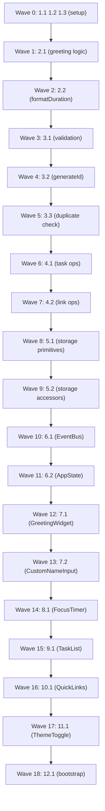

# Implementation Plan: Productivity Dashboard

## Overview

The Productivity Dashboard is a browser-only single-page app with no backend and no framework. Implementation follows the design's three-layer architecture inside a single `js/app.js` file: a **Pure Logic Layer** (stateless functions), a **Storage Layer** (`Storage_Manager`, the only module touching Local Storage), and a **Widget Layer** (ES6 classes owning DOM regions). A central `AppState` is the single source of truth, and a lightweight `EventBus` decouples cross-widget updates.

Tasks are ordered so each builds on the previous step and ends by wiring components together, with no orphaned code. Pure logic and storage are implemented first (no DOM needed), then `EventBus`/`AppState`, then widgets, and finally the bootstrap that wires everything on `DOMContentLoaded`.

The project produces exactly one `index.html`, one `css/styles.css`, and one `js/app.js`, with no framework references. Per NFR-1, no test setup is required and the project ships no test files.

## Tasks

- [x] 1. Set up project structure, HTML skeleton, CSS theming, and constants
  - [x] 1.1 Create index.html entry point
    - Add semantic containers for Greeting, Focus Timer, Task List, Quick Links, Theme Toggle, and Custom Name Input, plus an inline error region per widget and an unsupported-browser message container
    - Link css/styles.css and js/app.js; include no framework script tags
    - _Requirements: 9.4, 8.2_
  - [x] 1.2 Create css/styles.css with theming and layout
    - Define CSS custom properties for light and dark token pairs (background, surface, text, border) meeting a 4.5:1 contrast ratio per theme
    - Apply tokens via a `data-theme` attribute selector so theme switching is a single attribute change
    - Lay out widgets in a responsive grid; size widget titles larger than body content
    - Style completed tasks distinctly from incomplete tasks
    - _Requirements: 8.1, 8.3, 9.1_
  - [x] 1.3 Scaffold js/app.js structure and constants
    - Add "use strict" and a single IIFE/module scope; add section delimiter comments matching the design's module organization (Constants, Pure Logic, EventBus, Storage_Manager, AppState, Widgets, App bootstrap)
    - Define STORAGE_KEYS, LIMITS, and TIMER constants exactly as in the design
    - _Requirements: 5.1, 9.2, 9.3_

- [ ] 2. Implement pure logic — greeting and time formatting
  - [ ] 2.1 Implement getGreetingByHour(hour) and composeGreeting(hour, customName)
    - getGreetingByHour: 5-11 "Good morning", 12-16 "Good afternoon", 17-20 "Good evening", 21-23 or 0-4 "Good night"
    - composeGreeting: append ", [name]" only when customName is a non-empty valid name
    - _Requirements: 1.3, 1.4, 1.5, 1.6, 11.2, 11.5_
  - [ ] 2.2 Implement formatDuration(ms) returning "MM:SS"
    - Zero-pad minutes and seconds; clamp negative input to 0 so 0ms yields "00:00"
    - _Requirements: 2.1, 2.2, 2.4_

- [ ] 3. Implement pure logic — validation, ID generation, and duplicate detection
  - [ ] 3.1 Implement validation functions returning {valid, error}
    - validateTaskText: 1-200 chars, not whitespace-only
    - validateLinkName: 1-50 chars, not whitespace-only
    - validateLinkUrl: non-empty
    - validateCustomName: 1-50 chars, not whitespace-only
    - _Requirements: 3.7, 3.8, 4.6, 11.6_
  - [ ] 3.2 Implement generateId()
    - Use crypto.randomUUID() when available; fall back to timestamp + random suffix
    - _Requirements: 3.1, 4.2_
  - [ ] 3.3 Implement isDuplicateTask(tasks, newText, excludeId)
    - Case-insensitive, trimmed comparison; excludeId lets an edit ignore the task being edited
    - _Requirements: 12.1, 12.2_

- [ ] 4. Implement pure logic — task and link operations
  - [ ] 4.1 Implement pure task operations over a task list
    - createTask(text): returns {id (via generateId), text, completed:false}
    - editTask(tasks, id, text): updates text, preserves completed
    - toggleTask(tasks, id): flips completed (involution)
    - deleteTask(tasks, id): removes the task by id
    - _Requirements: 3.1, 3.2, 3.3, 3.4_
  - [ ] 4.2 Implement pure link operations over a link list
    - createLink(name, url): returns {id (via generateId), name, url}
    - deleteLink(links, id): removes the link by id
    - _Requirements: 4.2, 4.4_

- [ ] 5. Implement the Storage Layer (Storage_Manager)
  - [ ] 5.1 Implement Storage_Manager _read and _write primitives
    - _read(key, fallback): JSON.parse(localStorage.getItem(key)) with try/catch returning fallback on parse failure or absent key
    - _write(key, value): JSON.stringify + setItem with try/catch returning {ok, error}; catch QuotaExceededError and any setItem failure
    - _Requirements: 5.4, 5.5, 5.6_
  - [ ] 5.2 Implement typed Storage_Manager accessors
    - loadTasks/saveTasks, loadLinks/saveLinks (array fallback [])
    - loadTheme/saveTheme (fallback "light"), loadCustomName/saveCustomName (fallback null)
    - load* surfaces a load-failure indication on invalid JSON; save* returns {ok, error}
    - _Requirements: 5.1, 5.2, 5.3, 10.3, 10.5, 11.3_

- [ ] 6. Implement EventBus and AppState
  - [ ] 6.1 Implement EventBus class
    - on(event, handler) returns an unsubscribe function; emit(event, payload) notifies all handlers
    - Define events: theme:changed, customname:changed, state:tasks, state:links
    - _Requirements: 10.2, 11.2, 3.6, 4.5_
  - [ ] 6.2 Implement AppState as the single source of truth
    - Hold tasks, links, theme, customName
    - Mutators addTask/editTask/toggleTask/deleteTask/addLink/deleteLink/setTheme/setCustomName delegate persistence to Storage_Manager and emit the matching EventBus event; on save failure keep in-memory state and return {ok, error}
    - _Requirements: 3.5, 3.6, 4.5, 5.2, 10.2, 11.4_

- [ ] 7. Implement Greeting Widget and Custom Name Input
  - [ ] 7.1 Implement GreetingWidget
    - Render current local time (hh:mm:ss) updating once per second via setInterval(1000); render current local date
    - Render greeting via getGreetingByHour/composeGreeting; recompute greeting only when the hour changes; subscribe to customname:changed to re-render
    - _Requirements: 1.1, 1.2, 11.2, 11.4_
  - [ ] 7.2 Implement CustomNameInput
    - Validate via validateCustomName; on submit persist through AppState.setCustomName and emit customname:changed; show validation error inline
    - _Requirements: 11.1, 11.2, 11.3, 11.6_

- [ ] 8. Implement Focus Timer Widget
  - [ ] 8.1 Implement FocusTimer with an end-timestamp model
    - Initialize remainingMs to TIMER.DURATION_MS and render formatDuration -> "25:00"
    - start(): set endTime = Date.now() + remainingMs and start a 1s interval; if already running, continue without restarting
    - stop(): pause and store remainingMs = endTime - Date.now()
    - reset(): stop and restore remainingMs to DURATION_MS, render "25:00"
    - _tick(): remainingMs = max(0, endTime - Date.now()); render; at 0 stop and show completion message
    - _Requirements: 2.1, 2.2, 2.3, 2.4, 2.5, 2.6_

- [ ] 9. Implement To-Do List Widget
  - [ ] 9.1 Implement TaskList
    - addTask/editTask: validate, then duplicate check (excludeId on edit), then AppState mutator, then render; on validation or duplicate failure show inline error and preserve existing text on edit
    - toggleTask/deleteTask via AppState mutators; render with completed tasks visually distinguished
    - Show a save-failure error when Storage_Manager reports {ok:false}; keep the current display
    - _Requirements: 3.1, 3.2, 3.3, 3.4, 3.5, 3.6, 3.7, 3.8, 3.9, 12.1, 12.2_

- [ ] 10. Implement Quick Links Widget
  - [ ] 10.1 Implement QuickLinksWidget
    - Load saved links on render; addLink: validate name/url and enforce the 20-link cap, then AppState.addLink and render
    - openLink(url): window.open(url, '_blank', 'noopener'); deleteLink via AppState.deleteLink
    - Show inline errors for invalid input and save failure; preserve existing buttons on failure
    - _Requirements: 4.1, 4.2, 4.3, 4.4, 4.5, 4.6, 4.7_

- [ ] 11. Implement Theme Toggle Widget
  - [ ] 11.1 Implement ThemeToggle
    - toggle(): switch theme via AppState.setTheme, applyTheme by setting data-theme attribute / CSS variables, persist
    - On load apply saved theme (fallback "light"); emit theme:changed so all widgets update immediately
    - _Requirements: 10.1, 10.2, 10.3, 10.4, 10.5_

- [ ] 12. Implement App bootstrap and wire everything together
  - [ ] 12.1 Implement App bootstrap on DOMContentLoaded
    - Feature-detect localStorage, JSON, CSS custom properties, and setInterval; if missing, hide widgets and show the unsupported-browser message
    - Load persisted state via Storage_Manager into AppState; apply saved theme (fallback "light") and custom name
    - Construct all widgets with their root elements, AppState, and the EventBus; start the GreetingWidget clock; render all widgets
    - _Requirements: 5.1, 6.1, 6.2, 6.3, 10.4, 11.4_

## Notes

- All implementation tasks target the single js/app.js (plus index.html and css/styles.css for setup); the project produces no test files per NFR-1.
- Each task references specific requirements for traceability.
- Browser compatibility (6.1), performance (7.1/7.2), visual contrast (8.3), and cross-browser behavior are verified by manual review against the design, since no automated test suite is part of this project.

## Task Dependency Graph

```json
{
  "waves": [
    { "id": 0, "tasks": ["1.1", "1.2", "1.3"] },
    { "id": 1, "tasks": ["2.1"] },
    { "id": 2, "tasks": ["2.2"] },
    { "id": 3, "tasks": ["3.1"] },
    { "id": 4, "tasks": ["3.2"] },
    { "id": 5, "tasks": ["3.3"] },
    { "id": 6, "tasks": ["4.1"] },
    { "id": 7, "tasks": ["4.2"] },
    { "id": 8, "tasks": ["5.1"] },
    { "id": 9, "tasks": ["5.2"] },
    { "id": 10, "tasks": ["6.1"] },
    { "id": 11, "tasks": ["6.2"] },
    { "id": 12, "tasks": ["7.1"] },
    { "id": 13, "tasks": ["7.2"] },
    { "id": 14, "tasks": ["8.1"] },
    { "id": 15, "tasks": ["9.1"] },
    { "id": 16, "tasks": ["10.1"] },
    { "id": 17, "tasks": ["11.1"] },
    { "id": 18, "tasks": ["12.1"] }
  ]
}
```

## Task Dependency Diagram


